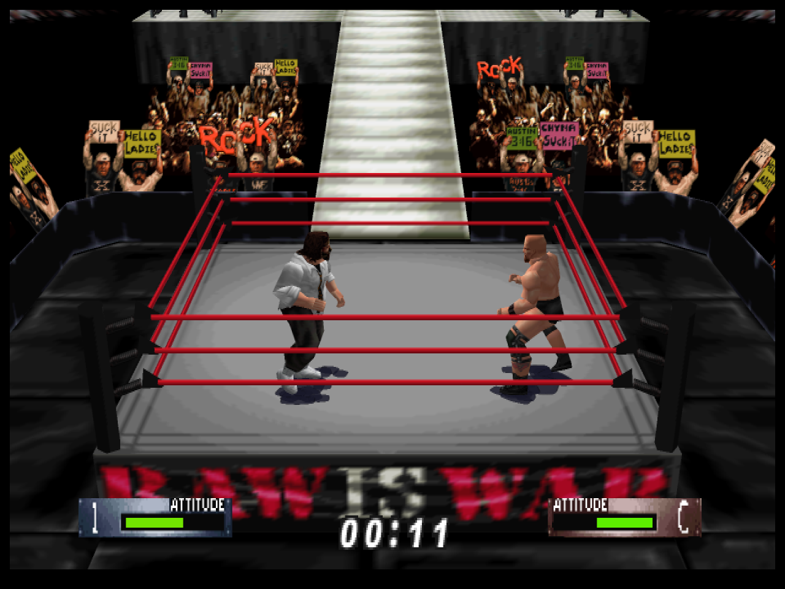
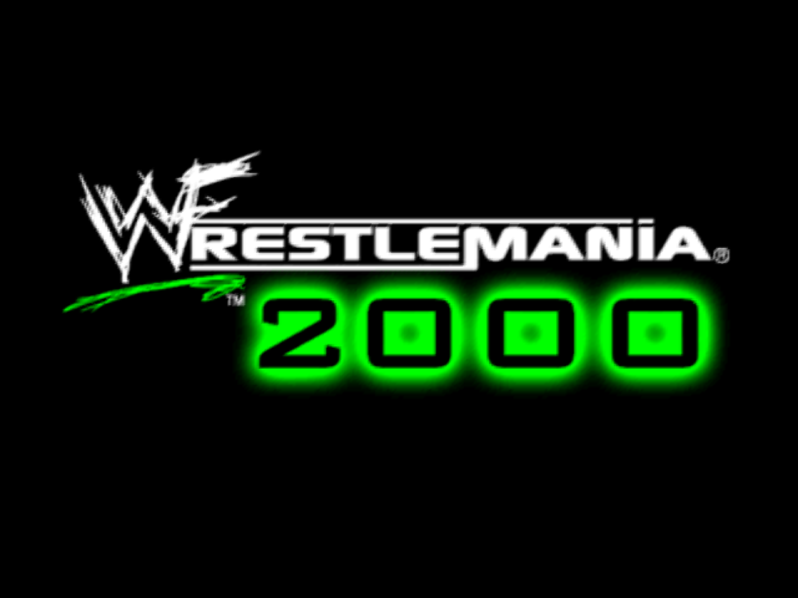
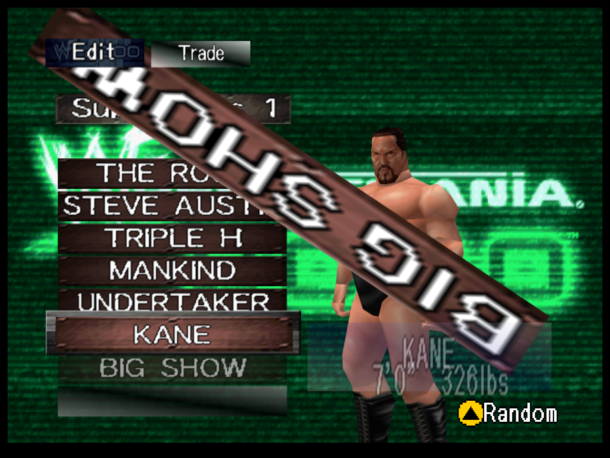

# WWF WrestleMania 2000: Recompiled

WWF WrestleMania 2000: Recompiled is a project that uses
[N64Recomp](https://github.com/N64Recomp/N64Recomp) to **statically recompile** the
Nintendo 64 game *WWF WrestleMania 2000* into a native PC port, running on the
[N64ModernRuntime](https://github.com/N64Recomp/N64ModernRuntime) with
[RT64](https://github.com/rt64/rt64) as the rendering engine. It is the third
project in the AKI wrestling recompilation family, after
[WCW vs. nWo World Tour: Recompiled](https://github.com/jessetbh/WCWvsNWOWorldTourRecomp)
and
[WCW/nWo Revenge: Recompiled](https://github.com/jessetbh/WCWnWoRevengeRecomp),
sharing their runtime stack and conventions.

### **This repository and its releases do not contain game assets. The original game is required to build or run this project.**

> **Status: beta.** The game boots, renders at high resolution, plays music and
> sound effects, takes keyboard and gamepad input through the menus and matches,
> rumbles, and both the cart save and the Controller Pak persist automatically.
> See [Known Issues](#known-issues) for what's still rough.

<div align="center">
  
  <br>
  
  
</div>

## Table of Contents
* [System Requirements](#system-requirements)
* [Features](#features)
  * [Plug and Play](#plug-and-play)
  * [Fully Intact N64 Effects](#fully-intact-n64-effects)
  * [Widescreen Support](#widescreen-support)
  * [Easy-to-Use Menus](#easy-to-use-menus)
  * [Controls Tailored to This Game](#controls-tailored-to-this-game)
  * [Cart Saves, Controller Pak, and Rumble Together](#cart-saves-controller-pak-and-rumble-together)
* [Planned Features](#planned-features)
* [FAQ](#faq)
* [Known Issues](#known-issues)
* [Mods and ROM Hacks](#mods-and-rom-hacks)
* [Building](#building)
* [Libraries Used and Projects Referenced](#libraries-used-and-projects-referenced)
* [Special Thanks](#special-thanks)

## System Requirements

Currently a **Windows** build is provided; other operating systems may be supported
later.

A GPU supporting Direct3D 12.0 (Shader Model 6) or Vulkan 1.2 is required. A CPU
supporting the SSE4.1 instruction set is also required (Intel Core 2 Penryn series or
AMD Bulldozer and newer).

If you have crashes on startup, make sure your graphics drivers are fully up to date.

## Features

#### Plug and Play

Provide your copy of the game and start playing! The project loads assets directly
from your ROM, so there is no separate extraction or build step.

#### Fully Intact N64 Effects

Rendering is hardware-accelerated through RT64 at high resolution, with the game's
original visual effects intact — no emulator-style workarounds or hacks.

#### Widescreen Support

With Aspect Ratio set to **Expand** (the default), the 3D scene renders at your
window's aspect ratio with a correctly widened field of view, while 2D interface
elements stay at their original proportions.

#### Easy-to-Use Menus

Press Esc (or your gamepad's Back/Select button) during play to open the config menu:
general settings, graphics settings, full input rebinding for keyboard and controller
(two bindings per input), and audio settings. Menus can be used with mouse, keyboard,
or controller.

#### Controls Tailored to This Game

Like the rest of the AKI wrestling family, WrestleMania 2000 moves on the N64
**d-pad** and taunts with the analog stick, so the default mappings are built for
that: move on the left stick *and* d-pad, taunt on the right stick, and the defensive
pair on mirrored triggers. Grapple = A, attack = X, run = B, climb/turnbuckle = Y,
switch focus = bumpers. Keyboard: WASD moves, IJKL taunts, Space/Shift/Q/E/R for the
face buttons. Everything is rebindable in the in-game menu.

#### Cart Saves, Controller Pak, and Rumble Together

WrestleMania 2000 saves game progress to the cartridge's battery-backed SRAM and
uses a Controller Pak for extra created-wrestler storage — and on real hardware the
pak occupies the same controller slot a Rumble Pak needs. The port emulates all
three at once: the cart save and a virtual Controller Pak each persist to their own
file automatically, *and* your gamepad rumbles during matches. No juggling.

## Planned Features

* High framerate support (frame interpolation) — see [Known Issues](#known-issues)
* Linux support
* Mod support

## FAQ

#### What is static recompilation?

Static recompilation is the process of automatically translating an application from
one platform to another — here, the game's original MIPS machine code is translated
into C and compiled for modern PCs. For details, see
[N64Recomp](https://github.com/N64Recomp/N64Recomp). **This is not an emulator and not
a decompilation.**

#### How is this related to a decompilation project?

It isn't — no public decompilation of WWF WrestleMania 2000 exists. Unlike most
recompilation ports, which borrow symbol names from a decomp, this project generated
its own symbol metadata from scratch via a [splat](https://github.com/ethteck/splat)
disassembly (see `disasm/` and `syms/`), transferring libultra identifications from
its sister project WCW/nWo Revenge by machine-code fingerprinting.

#### Where is the savefile stored?

- Windows: `%LOCALAPPDATA%\Wm2kRecompiled\saves\`

Both save files live there: the cart SRAM image (game progress, created wrestlers)
and the virtual Controller Pak image. Configuration files and the log file live one
level up in the same app folder. Save data is preserved across updates.

#### Can you run this project as a portable application?

Yes — place a file named `portable.txt` in the same folder as the executable and
saves, config files, and the stored ROM will be kept next to the executable instead.

#### How do I choose a different ROM?

**You don't.** This project is **only** a port of WWF WrestleMania 2000, and it only
accepts one specific ROM: the USA **V1.2** release
(SHA1 `D7D1FAD473FEF9B61FE5F8273C975EE7C603A51B`). Earlier USA revisions (V1.0/V1.1)
and other regions are **not** accepted. **It is not an emulator and it cannot run any
arbitrary ROM.**

You can't accidentally load the wrong file — the launcher validates the ROM before
storing its own copy (so the original file can be moved or deleted afterwards). If the
stored copy ever goes missing or gets corrupted, the launcher simply offers **Load
ROM** again.

## Known Issues

* **Frame interpolation is disabled** (Framerate is locked to Original). Like its
  sister games, WrestleMania 2000 builds each visual frame from several RSP tasks and
  submits fully composed matrices, which defeats RT64's frame-interpolation
  heuristics — interpolated frames warp geometry. High-framerate support needs
  game-side matrix-group patches and is planned.
* Multi-controller (2+ player) sessions are still being stabilized and can crash in
  certain modes.
* Overlays such as MSI Afterburner and other software such as Wallpaper Engine can
  cause performance issues that prevent the game from rendering correctly. Disabling
  such software is recommended.

## Mods and ROM Hacks

This port loads mods in the `.nrm` format used by the N64: Recompiled projects.

#### Installing a mod

Copy the `.nrm` file into the game's mods folder and start the game:

- Windows: `%LOCALAPPDATA%\Wm2kRecompiled\mods\` (or `mods\` next to the executable in portable mode)

New mods are switched on by default. Builds with the in-game **Mods** menu (Settings → Mods)
can also install mods there (**Install Mods**, or drag the file onto the window) and switch
them on and off. Mods are applied when the game starts, so restart after changing them. To
remove a mod, delete its file.

#### ROM hacks as patch mods

A ROM hack can run as a *patch mod*: a mod that holds only a patch against the stock ROM. The
game applies it to your own ROM when it starts, and any game code the hack changes is
recompiled on the fly. It works for hacks that:

- are built on the same ROM this port uses (see the ROM's SHA1 above), and
- change code only inside the game's existing functions (data changes of any size are fine).

Hacks that rebuild or move the game's code, or are made for another revision, need a full
recompile and can't run as patch mods. Only one patch mod can be on at a time; each one keeps
its own saves in `saves\<mod id>\`, apart from the stock game's.

To make one from a hack ROM you have patched yourself (both ROMs must be big-endian `.z64`):

```
python tools\romhack\make_patch_mod.py --base wm2k.z64 --hack my_hack.z64 --game-id wwfwm2k --id my_hack --name "My Hack" --out my_hack.nrm
```

Run it from a checkout of this repository after building. It reports what the hack changes
and refuses hacks that need a full recompile; see [tools/romhack/README.md](tools/romhack/README.md).
Patch mods can contain the hack's and the original game's data, so **don't share patch mods
you don't have the rights to**: make your own from your own ROMs.

No ROM hacks for WrestleMania 2000 have been tested yet; the tool's report will tell you whether one can work.

## Building

Building is **not** required to play — grab a release instead. To build from source,
see [BUILDING.md](BUILDING.md).

## Libraries Used and Projects Referenced

* [N64Recomp](https://github.com/N64Recomp/N64Recomp) — the static recompiler this
  port is built with
* [N64ModernRuntime](https://github.com/N64Recomp/N64ModernRuntime) — the modern
  runtime (ultramodern + librecomp)
* [RT64](https://github.com/rt64/rt64) — the rendering engine
* [RecompFrontend](https://github.com/N64Recomp/RecompFrontend) — launcher, config
  menus, and input stack
* [RmlUi](https://github.com/mikke89/RmlUi) for building the menus and launcher
* [lunasvg](https://github.com/sammycage/lunasvg) for SVG rendering, used by RmlUi
* [FreeType](https://freetype.org/) for font rendering, used by RmlUi
* [SDL2](https://www.libsdl.org/) for windowing, input, and audio
* [moodycamel::ConcurrentQueue](https://github.com/cameron314/concurrentqueue) for
  semaphores and fast, lock-free MPMC queues
* [Gamepad Motion Helpers](https://github.com/JibbSmart/GamepadMotionHelpers) for
  sensor fusion and calibration algorithms
* [DirectX Shader Compiler](https://github.com/microsoft/DirectXShaderCompiler),
  [zstd](https://github.com/facebook/zstd),
  [nativefiledialog-extended](https://github.com/btzy/nativefiledialog-extended), and
  [plume](https://github.com/renderbag/plume) via RT64
* [splat](https://github.com/ethteck/splat) / spimdisasm for the disassembly that
  produced this project's symbol metadata
* [Inter](https://rsms.me/inter/), [Noto Emoji](https://fonts.google.com/noto), and
  [PromptFont](https://shinmera.com/promptfont) fonts (OFL; PromptFont license in
  `assets/promptfont/`)
* [SDL_GameControllerDB](https://github.com/gabomdq/SDL_GameControllerDB) for
  community controller mappings
* [WCW vs. nWo World Tour: Recompiled](https://github.com/jessetbh/WCWvsNWOWorldTourRecomp),
  [WCW/nWo Revenge: Recompiled](https://github.com/jessetbh/WCWnWoRevengeRecomp),
  [Bomberman Hero: Recompiled](https://github.com/RevoSucks/BMHeroRecomp), and
  [Zelda64Recomp](https://github.com/Zelda64Recomp/Zelda64Recomp) as reference
  projects for structure and conventions

## Special Thanks

* [Wiseguy](https://github.com/Mr-Wiseguy) and
  [DarioSamo](https://github.com/DarioSamo) for creating N64Recomp and RT64.
* [RevoSucks](https://github.com/RevoSucks) and the Bomberman Hero: Recompiled
  project, the template for this port's sister projects and therefore for this one.
* The Zelda64Recomp team for establishing the conventions the whole recomp ecosystem
  follows.
* ethteck and the splat/spimdisasm contributors — the disassembly tooling that made a
  no-decomp recompilation possible.
